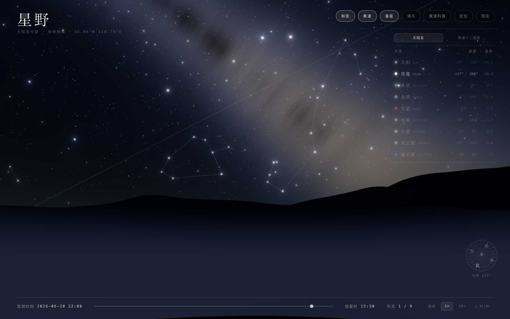
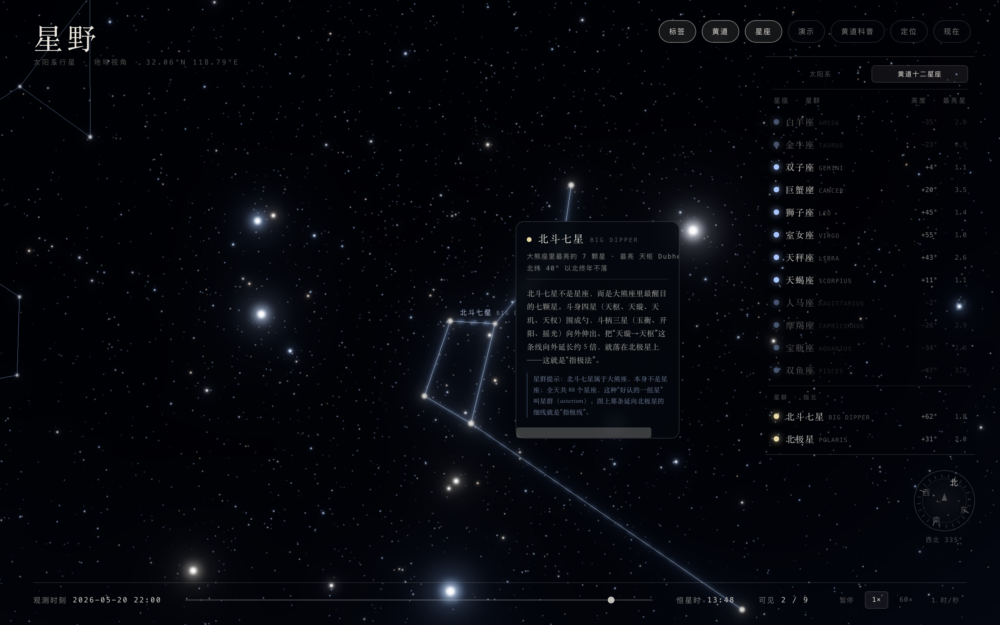

# 星野

**从地球仰望星空的太阳系科普页。** 纯前端，单文件，零外部请求，打开就进夜 —— 为课堂与科学普及而写，不是占星软件。



> 2026-06-20 22:00，北纬 32.06°、东经 118.79°。黄道（金线）横穿天蝎与人马，右侧是该时刻九个天体的实测高度与星等。



> 2026-05-20 22:00。北斗作为「星群」独立成层：斗身四星、斗柄三星，再加一条延向北极星的指极线；点它即弹卡片，讲清「星群不是星座」和「指极法」。

---

## 它是什么

把 JPL 的行星根数、恒星的 J2000 赤道坐标，一起换算到你**此刻头顶那片天**，再叠一层能点、能讲、能自动演示的教学 HUD。

- **位置是真的**：太阳、月亮、水星、金星、火星、木星、土星、天王星、海王星，走 JPL 近似 Keplerian 根数（Standish，1800–2050），口径与精度已与独立 Python 实现交叉校验。
- **天空是真的**：5 万星 GPU 星场、程序化银河、三层远山与水面倒影、Bloom + ACES 色调映射。
- **土星环比例是真的**：外缘 2.27× 行星半径、内缘 1.24×，每帧把点精灵的像素直径换算成同距离下的世界尺寸，所以 58° 和 7° 视场下球与环的关系一致，不会「越放大环越大」。
- **星座是能点的**：黄道十二星座，88 颗 J2000 亮星 + 76 段轮廓连线；点星空命中**具体一颗星**，弹的是这颗星自己的卡片。
- **星群单独成层**：北斗七星 + 北极星不塞进十二星座，而是作为「星群 · 指北」独立分组，含天璇→天枢→北极星的指极线。
- **课堂不用手动点**：`?tour=1` 自动播放四步动线，也可点右上「演示」。

## 界面上有什么


|            | 说明                                                                                                                             |
| ---------- | -------------------------------------------------------------------------------------------------------------------------------- |
| 右上七胶囊 | 标签 / 黄道 / 星座 / 演示 / 黄道科普 / 定位 / 现在                                                                               |
| 右侧清单   | 双 Tab：**太阳系**（九天体 + 高度 + 星等）、**黄道十二星座 · 星群**（高度 + 最亮星）；点任一行即对准并弹卡                      |
| 卡片       | 天体：名称、直径、距地、简介；星座/星群：最亮星、最佳季节、科普 + 固定提示；单星：星官名、西名、拜耳字母、星等、距地、该亮星科普 |
| 底部       | 观测时刻、24h 时间滑杆、四档速度（开始/暂停）、可见天体计数                                                                      |
| 右下       | 罗盘：东、南、西、北 + 当前方位角                                                                                                |
| 星点       | 天体 1046Hz、星座 1180Hz、单星 1260Hz 三档「叮」，音高区分你点到了什么                                                           |

## 科学不糊弄的几处

科普软件最容易在「好看」和「对」之间走偏，这里刻意处理了几件事：

- **宫 ≠ 星座**：卡片里明确区分黄道十二宫（占星等分的 30° 区间）与实际星座（大小不等、边界来自 1930 年 IAU 划定）。
- **第 13 个星座**：`H` 键的「黄道科普」弹窗讲清黄道、黄道带（约 18° 宽）、岁差（25,800 年一周、每年西移 50.3″、约 72 年 1°），以及太阳每年 11 月 29 日–12 月 17 日实际穿过蛇夫座。
- **星等不是光度**：单星卡片固定提示「星等是看上去有多亮，数值越小越亮，与真实光度不是一回事；距离意味着看到的是它若干年前的光」。
- **连线是示意**：星座轮廓按传统图形勾（狮子镰刀、天蝎长尾、人马茶壶），**不是 IAU 官方 stick figure**，README 与代码里都写明了。
- **北斗会「变形」**：它的姿态随时刻和纬度变化，高纬度夏季傍晚会压成一条窄链 —— 这是真实的，不是连线画错。

## 快速开始

页面用 importmap 引本地 three.js，必须走 HTTP（`file://` 会被 CORS 挡下）：

```bash
cd douzhuan-xingyi
python3 -m http.server 8765
# 打开 http://127.0.0.1:8765/
```

无构建、无 npm 依赖。`three.module.js`（r187）、`three.core.js`、`jsm/` 都已随仓库附带，断网也能跑。

## URL 参数


| 参数                          | 作用                                           |
| ----------------------------- | ---------------------------------------------- |
| `?at=2026-06-20T22:00`        | 钉死观测时刻（否则取当前时间）                 |
| `?lat=32.06&lon=118.79`       | 覆盖观测点（默认南京；页面内也有 GPS「定位」） |
| `?yaw=0.30&pitch=0.75&fov=52` | 钉死视角与视场；带`yaw` 时不跑开场自动对准     |
| `?info=1`                     | 入夜后自动打开黄道科普弹窗                     |
| `?tour=1`                     | 入夜后自动播放演示动线                         |
| `?v=N`                        | 强刷版本号（改代码后浏览器缓存很顽固）         |

组合示例：

```
/?v=93&at=2026-05-20T22:00&lat=32.06&lon=118.79&yaw=0.30&pitch=0.75&fov=52
```

## 键盘

`1`–`8` 对准八大行星、`0` 对准太阳、`L` 标签、`E` 黄道、`C` 星座、`H` 黄道科普、`Esc` 关卡片/弹窗/退出演示、拖拽转视角、单滚轮推时间、`Ctrl`/`⌘` + 滚轮缩视场。

## 坐标链

```
JPL 根数 ─► 日心黄道 (x,y,z) ─► 地心矢量 ─► 黄道转赤道 (OBLIQ 23.4392911°) ─► skyMatrix(LST) ─► 地平坐标 ─► 相机
                                                                                    ▲
恒星 / 星座 / 星群：J2000 (RA, Dec) ────────────────────────────────────────────────┘
```

- 天球半径固定 `SKY_R = 900`，天体走点精灵；`gl_PointSize` 由「视场 + 视星等」反解，缩放时亮度与视觉尺寸都不跳。
- 星座与星群统一进 `GROUPS`（每组含 `stars`：赤经 h / 赤纬 ° / 视星等，`lines`，展平后的 `cRange`）。星群的「观看中心」只取本体 `member` 颗，指极线外挂的北极星不参与平均 —— 否则点清单对准时勺子会跑出画面。
- 单星科普数据在 `STARINFO`（键为 `group.key:index`，约 60 条，含星官名/西名/拜耳字母/距离/科普句）；缺条目的连线星走兜底文案，不会出现空白卡。

## 精度与免责

- 行星位置为 JPL 近似根数 + 截断级数，误差远小于一屏像素，但**不适用于精密星历需求**。
- 月亮用 Meeus 截断级数；点精灵是实心盘，无相位视觉表现，只有星等随相位变化。
- 星座连线为示意轮廓，非 IAU 官方 stick figure。
- 方位角以正北为 0°、顺时针增加；页面底部罗盘与 `heading = -yaw` 一致。

## 目录

```
index.html                     主页面（单文件：GLSL、星历、HUD 全在里面）
three.module.js                three.js r187（MIT）
three.core.js
jsm/                           postprocessing / shaders 子模块
docs/行星页-需求分析与技术方案.md    需求拆解、技术路线评估、坐标链、里程碑
docs/screenshots/              README 用截图（1440×900 @2x）
```

## 许可

代码 MIT，见 [LICENSE](LICENSE)。`three.module.js` / `three.core.js` / `jsm/` 来自 [three.js](https://threejs.org/)（MIT，Copyright © 2010-2026 Three.js Authors），保留其原有许可声明。
