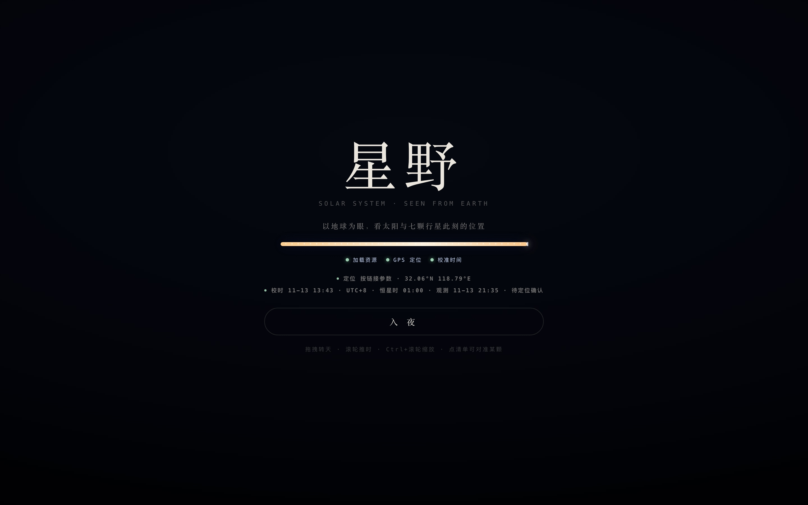
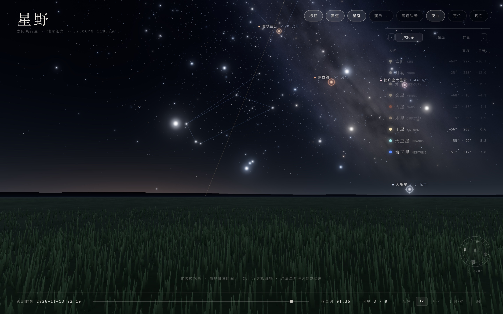
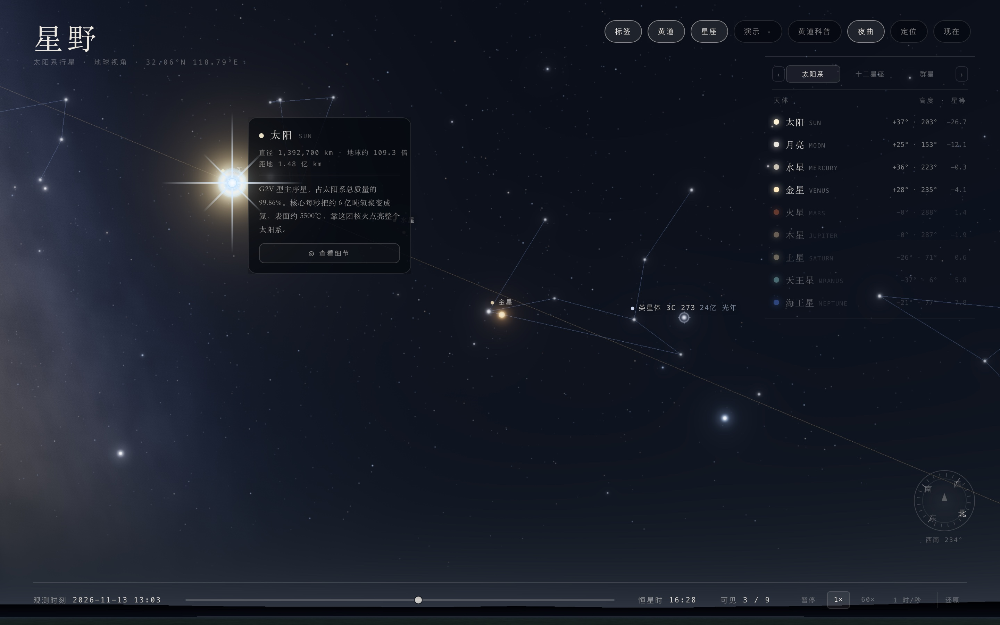
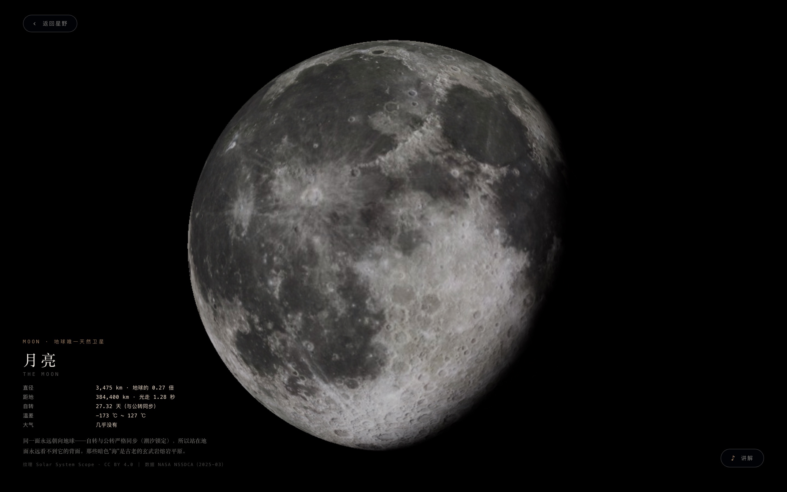
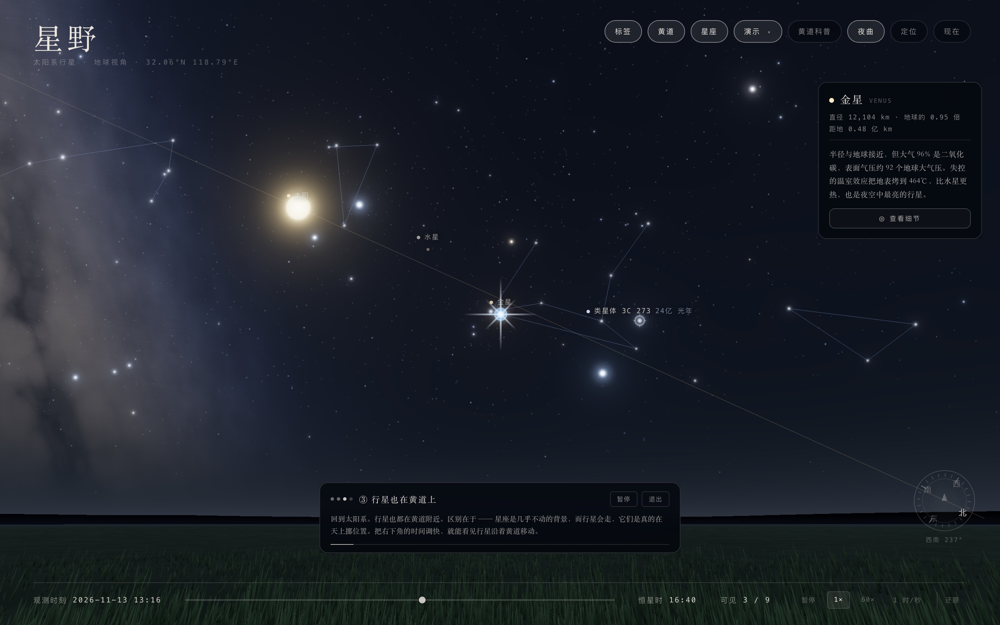

# 星野

**把此刻头顶的那片星空搬到屏幕上。** 纯前端单文件 WebGL 天文科普页：按你的位置和时间，算出太阳系行星、黄道十二星座与著名深空天体的真实位置，可以点、可以讲、也能自动演示 —— 为课堂与科学普及而写，不是占星软件。



> 开门之前先过一道闸门：`加载资源` → `GPS 定位` → `校准时间` 三段进度各占一颗星，星河流动到 100% 且三段都落地，`入 夜` 才浮出来。定位卡死 10 秒兜底放行；`?cine=0` 直落开门，供截图与调试。

## 它做什么

| | |
| --- | --- |
| **位置是真的** | 太阳、月亮、水星、金星、火星、木星、土星、天王星、海王星走 JPL 近似 Keplerian 根数（Standish，1800–2050），换算到你此刻的地平坐标；恒星、星座、深空天体取 J2000 赤经赤纬走同一条坐标链 |
| **天空是真的** | 5 万颗 GPU 星点、程序化银河（银道坐标当噪声域，不贴图）、草原地平线与远山剪影、Bloom + ACES 色调映射 |
| **三层内容** | `太阳系`（九颗天体 + 高度 + 星等）· `十二星座`（88 颗亮星 + 示意轮廓，可点单星）· `群星`（北斗 + 北极星指极线，加一条「尺度阶梯」八个深空天体） |
| **点一下有反馈** | 在星幕上点中一颗星，星光**爆闪一次**（十字星芒 + 双向扩散环 + 白核 + 星尘），卡片弹在该星**右侧**跟随移动；点标签、面板、卡片、菜单等 UI 不触发闪光也不会误选星 |
| **能进去看** | 九颗天体各有独立特写：真实反照图（Solar System Scope，CC BY 4.0）、真实转轴与自转比例、缓慢自转（80–240 秒一圈）、单侧光做出晨昏线与大气亮边；右下角 `♪ 讲解` 播一段 100 字以内的女声科普 |
| **课堂能自动讲** | 右上 `演示` 下拉两条动线：**系统演示**（黄道 → 星座 → 行星 → 岁差）与 **光走了多久**（南门二 4.4 光年 → 3C 273 24 亿光年）。每步配女声旁白，步长跟这一段音频的真实时长走；镜头先**转到目标天体再开讲**，到位那一刻同样闪一次星芒 |

## 图说



> 2026-11-13 22:10，北纬 32.06°。猎户座、天狼星与银河同框；右上三 Tab 清单给出此刻九个天体的高度与星等，右下罗盘给方位角，底部是观测时刻与 24 小时时间滑杆。尺度阶梯的天体（天狼星 8.6 光年、参宿四 550 光年、蟹状星云 6500 光年）常显标签。



> 点中太阳的那一下：一次性 `.flash` 元素在命中处爆开，卡片带直径、距地、简介，从星体右侧展开。闪烁只是 DOM 层动画，`pointer-events:none`、0.8 秒后自毁，不进渲染管线、不留状态。



> 卡底 `查看细节` → 星光朝目标径向飞逝、过一道白闪，进入这颗星自己的场景。场景里可拖拽绕行、滚轮改视场，`Esc` 或 `返回星野` 退出。



> 系统演示第③步「行星也在黄道上」：镜头转到金星，星芒在它身上亮一下，右侧留卡片、底部给讲解词与进度条。选完动线不会立刻开演 —— 先把整条旁白真正下载完，期间给一枚黑底绿环加载器（环里滚进度、`n / 总段数`、可取消），开演第一句即本地解码出声。

## 界面速查

| | 说明 |
| --- | --- |
| 右上胶囊 | 标签 / 黄道 / 星座 / 演示 / 黄道科普 / 夜曲 / 定位 / 现在 |
| 右侧清单 | 三 Tab 平分面板宽度，`‹ ›` 方块按钮翻组；点任一行对准并弹卡；条目多了清单自己滚，Tab 与表头钉顶 |
| 卡片 | 天体：直径、距地、简介；星座/星群：最亮星、最佳季节、科普；单星：星官名、西名、拜耳字母、星等、距地 |
| 底部 | 观测时刻、24h 时间滑杆、四档速度、可见天体计数、「还原」回到入场取景 |
| 声音 | 天体 1046Hz、深空天体 1120Hz、星座 1180Hz、单星 1260Hz 四档「叮」；夜曲是 106 秒无缝循环的草原夜氛围声，点胶囊开关（偏好记 localStorage） |
| 移动端 | 触屏拖拽转视角、松手带惯性滑行；点按命中半径与桌面一致 |

## 科普上不糊弄

- **宫 ≠ 星座**：黄道十二宫是占星等分的 30° 区间，实际星座大小不等、边界来自 1930 年 IAU 划定。
- **第 13 个星座**：`黄道科普` 弹窗讲清黄道、黄道带（约 18° 宽）、岁差（25,800 年一周、每年西移 50.3″），以及太阳每年 11 月 29 日–12 月 17 日实际穿过蛇夫座。
- **星等不是光度**：单星卡片固定提示「星等是看上去有多亮，与真实光度不是一回事；看到的是它若干年前的光」。
- **连线是示意**：轮廓按传统图形勾（狮子镰刀、天蝎长尾、人马茶壶），不是 IAU 官方 stick figure；北斗的姿态随时刻变化，压成窄链是真实的。
- **地平线守卫**：南门二在南京纬度永不升起（最高约 −2.7°），演示到它只弹卡片 + 一句提示，不把镜头压到地平线以下。

## 快速开始

页面用 importmap 引本地 three.js，必须走 HTTP（`file://` 会被 CORS 挡下）：

```bash
cd douzhuan-xingyi
python3 -m http.server 8765
# 打开 http://127.0.0.1:8765/
```

无构建、无 npm 依赖。`three.module.js`（r187）、`three.core.js`、`jsm/` 已随仓库附带，断网也能跑。

## URL 参数与键盘

| 参数 | 作用 |
| --- | --- |
| `?at=2026-06-20T22:00` | 钉死观测时刻（默认取当前时间，白天打开会落到 21:30） |
| `?lat=32.06&lon=118.79` | 覆盖观测点（默认南京；页面内也有 GPS `定位`） |
| `?yaw=0.30&pitch=0.75&fov=52` | 钉死视角与视场；带 `yaw` 时不跑开场自动对准 |
| `?info=1` / `?tour=1` | 入夜后自动打开黄道科普 / 自动播放系统演示 |
| `?cine=0` | 直落开门（截图与调试用） |
| `?v=N` | 强刷版本号（改代码后浏览器缓存很顽固） |

键盘：`0`–`8` 对准太阳与八大行星，`L` 标签、`E` 黄道、`C` 星座、`H` 黄道科普、`Esc` 关卡片/弹窗/退出演示；拖拽转视角，单滚轮推时间，`Ctrl`/`⌘` + 滚轮缩视场。

## 目录

```
index.html                     单文件主页面（GLSL、星历、HUD 全在里面）
three.module.js / three.core.js / jsm/    three.js r187 与本页用到的子模块
assets/audio/                  九颗天体的「♪ 讲解」女声（<key>.wav，16 kHz 单声道）
assets/tour/                   演示旁白：系统演示 nar-1…5.mp4、光走了多久 light-1…8.wav
docs/screenshots/              README 截图（1440×900 @2x）
docs/行星页-需求分析与技术方案.md    需求拆解、坐标链、里程碑
```

## 数据来源与免责

- 行星为 JPL 近似根数 + 截断级数，月亮用 Meeus 截断级数：误差远小于一屏像素，但**不适用于精密星历**。
- 天体参数取自 NASA NSSDCA *Planetary Fact Sheet*（2025-03）；表面图片来自 Solar System Scope（CC BY 4.0），页面 HUD 内标注署名。
- 讲解词与「光走了多久」旁白均为文字转语音生成（成年女性音色、纯人声），文案对应真实距离与年份。
- 代码 MIT，见 [LICENSE](LICENSE)；`three.module.js` / `three.core.js` / `jsm/` 来自 [three.js](https://threejs.org/)（MIT）。
